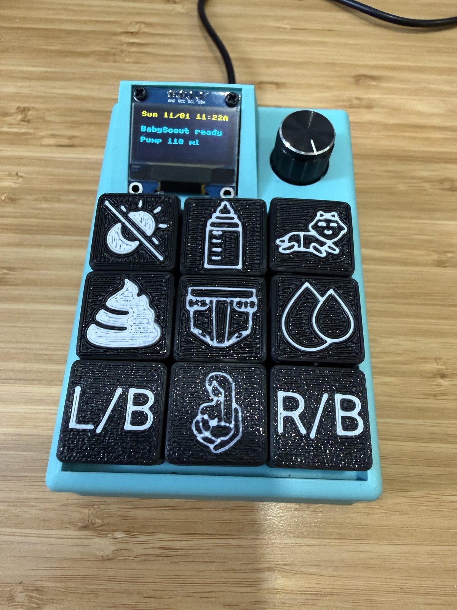
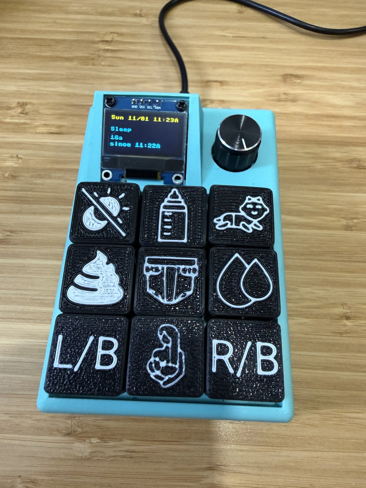
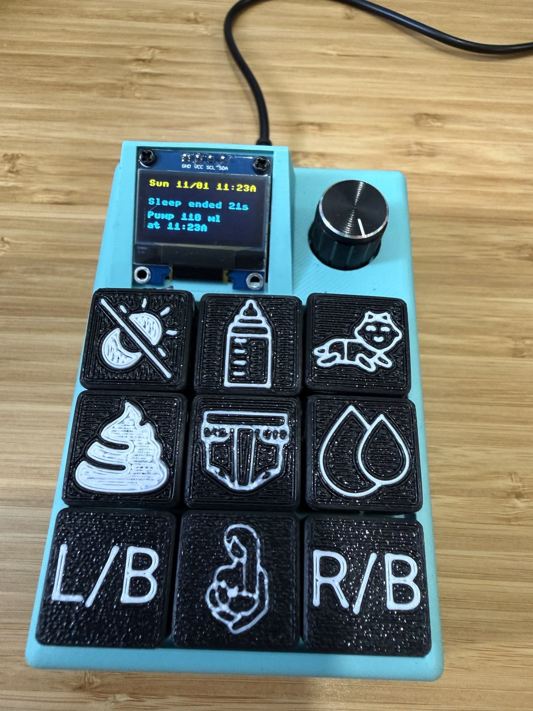

# BabyScout

A Raspberry Pi Pico W baby-activity tracker for
[BabyBuddy](https://github.com/babybuddy/babybuddy): nine physical buttons and
a rotary encoder record sleep, diapers, feeds, tummy time and breast-pump
volume with one press, and an SSD1306 OLED shows exactly what happened.

No phone, no browser, no app — the buttons are the interface. Every action is
logged to BabyBuddy over WiFi, and the display/LED give honest feedback about
whether it was actually recorded.

This is a fork of [MikeSchapp/BabyScout](https://github.com/MikeSchapp/BabyScout)
(Michael Schappacher, BSD-2-Clause — see [LICENSE](LICENSE)): the original
project's one-button-per-activity concept, extended with an EC11 encoder row,
an SSD1306 OLED and the hardened WiFi/timer design documented below.

## What it looks like

The reference build: the 3D-printed macropad from *Bill of materials*, labeled
two-color keycaps, the EC11 pump knob, and the SSD1306 display.

<p align="center">
  
  
  
</p>

## Differences from the original

Compared to [MikeSchapp/BabyScout](https://github.com/MikeSchapp/BabyScout)
(same BabyBuddy integration and `secrets.json` layout):

- **No offline web-server fallback.** When it has no matching network or
  BabyBuddy setup, the original turns the Pico into a WiFi access point
  ("BabyScout" / password "BabyBuddy") and serves a web page that configures
  `secrets.json`. That's removed here — the Pico is a pure client: an
  unreachable BabyBuddy just means keep retrying, a blinking LED and a
  `not ready` screen (see *Display and LED states* below).
- **9 keys instead of 8** — adds Tummy Time; the switches are wired to GND
  (internal pull-UP, press = LOW) instead of the original's 3V3 (pull-DOWN,
  press = HIGH).
- **EC11 rotary encoder** — breast-pump support, which the original had no
  concept of: turning sets the volume (10–500 ml, auto-saved to flash), the
  center press starts/stops the pump timer.
- **SSD1306 OLED status display + live NTP clock** — the original had no
  display; its only feedback was the onboard LED and the serial console.
- **Hardened WiFi/timer handling** — CYW43 cold-boot warmup and association
  retries, stale-timer cleanup, time-boxed NTP sync.
- **Pico 2 W support** — the original targets the Pico W; either works here.
- **Enclosure** — the 3D-printed macropad from *Bill of materials* instead of
  the original's case.
- **Dev tooling** — byte-verified `make deploy` / `verify` scripts and a
  larger host-side test suite.

## Controls

| Input | Action |
|---|---|
| GP2 button | Sleep (start/stop timer) |
| GP3 / GP4 / GP5 | Solid / Wet + Solid / Wet diaper (immediate) |
| GP6 | Bottle feed (start/stop timer) |
| GP7 / GP8 / GP9 | Left breast / Breast feed / Right breast (start/stop timer) |
| GP10 | Tummy time (start/stop timer) |
| EC11 turn | Pump volume, ±5 ml per detent (10–500 ml, saved ~2 s after you stop turning) |
| EC11 center press | Breast pump (start/stop timer) |

Timed actions toggle: the first press starts a BabyBuddy timer, the second
press stops and records it. The OLED shows `started`, the live elapsed time,
then `ended <duration>`.

Full pinout, parts list and wiring diagram: **[wiring.md](wiring.md)**.

## Bill of materials

Everything except the Pico is interchangeable — the links are the parts used for
the reference build.

| Part | Used | Notes |
|---|---|---|
| 1× microcontroller | [Raspberry Pi Pico 2 W](https://www.raspberrypi.com/products/raspberry-pi-pico-2/?variant=pico-2-w) | an original [Pico W](https://www.raspberrypi.com/products/raspberry-pi-pico/) works too |
| 1× status display | [ELEGOO 0.96" SSD1306 OLED](https://www.amazon.com/ELEGOO-Display-Compact-Self-Luminous-Projects/dp/B0D2RMQQHR) | the **I2C** version, not SPI; any 0.96" 128×64 SSD1306 module works |
| 1× rotary knob | [EC11 encoder with center push](https://www.amazon.com/dp/B0G48Z8B9Q) | turn = pump volume, center press = breast pump |
| 9× keys | [blue MX-style switches](https://www.amazon.com/s?k=keyboard+switches+blue+mx&i=electronics) | clicky tactiles; any momentary 100%-pitch switch works |
| 1× enclosure | ["Raspberry Pi Pico Macropad"](https://www.printables.com/model/542200-raspberry-pi-pico-macropad) by Jason Giroux on Printables | 3D-printed |
| ~25 wires | — | soldered direct to the Pico and the parts; plus a micro-USB cable (5 V power) |

For labeled keys, the [Vostok Labs keycap legend generator](https://vostoklabs.github.io/SVG-keycap-generator/)
turns any text or icon into a print-ready two-color 3MF keycap — printing one per
action (`SLEEP`, `WET`, ...) makes the pad self-explanatory at arm's reach.

## Repository layout

```
main.py                 app entry point: boot, buttons, encoder, display, loop
lib/scout.py            BabyBuddy API client + timer start/stop logic
lib/utils.py            secrets loading/cache, logging, duration formatting
lib/display.py          optional SSD1306 OLED (missing display is a no-op)
lib/pin.py              buttons, status LED, debounce
lib/encoder.py          EC11 quadrature decoder
picoconnection/         WiFi association (multi-SSID, retries)
tests/                  host-side pytest suite (MicroPython modules stubbed)
scripts/                deploy + byte-verify helpers
```

## Setup

**Your port:** the commands below use `COM6` as an example serial port; yours
differs per machine. On Windows, plug the Pico in and list ports with
`python.exe -c "import serial.tools.list_ports as lp; [print(p.device) for p in lp.comports()]"`;
on Linux/macOS it is usually `/dev/ttyACM0` (see *Linux / macOS* below). Pass
your port with `PORT=...` in the commands.

1. Flash **MicroPython** for the Pico 2 W from
   [micropython.org](https://micropython.org/download/RPI_PICO2_W/): hold
   BOOTSEL while plugging in the micro-USB lead, then copy the `.uf2` file
   onto the `RP2350` drive. The original Pico W works too
   ([RPI_PICO_W](https://micropython.org/download/RPI_PICO_W/)).
2. Create `secrets.json` in the repo root (never commit it):

   ```json
   {
     "SSIDS_PASSWORD": {
       "YourWiFiSSID": "your-wifi-password"
     },
     "BASE_URL": "https://your-babybuddy-tunnel.example/api/",
     "AUTHORIZATION": {
       "Authorization": "your-babybuddy-token"
     }
   }
   ```

   `SSIDS_PASSWORD` may contain several networks; they are tried in order.
   `BASE_URL` must include the API prefix (`/api/`). The token may be given
   with or without the `Token ` prefix.
3. Copy `secrets.json` to the device **once** (it is not part of a normal
   deploy, and `make deploy` never overwrites it):

   ```bash
   python.exe -m mpremote connect COM6 cp secrets.json :secrets.json
   ```

4. Deploy the code:

   ```bash
   make deploy PORT=COM6
   ```

   The script copies every source file, reads each one back, byte-compares it,
   and resets the Pico. Use `make verify PORT=COM6` to check an existing device
   without changing it.

### Linux / macOS

`python.exe` is the WSL bridge to the Windows Python that owns the COM port.
On a native Linux/macOS host use the device node instead:

```bash
make deploy PORT=/dev/ttyACM0 MPREMOTE="python3 -m mpremote"
```

## Development

The pure logic (encoder decoding, duration formatting, timer toggle decisions,
display truncation, debounce) is tested on the host with MicroPython modules
stubbed out:

```bash
make test      # pytest
make compile   # py_compile every source file
make check     # both
```

There is no CI; run `make check` before deploying.

## Display and LED states

| Situation | OLED | LED |
|---|---|---|
| Booting | `BabyScout` / `starting up...` | off, then blinking while not ready |
| Ready | `BabyScout ready` / `Pump <vol> ml` | solid on |
| Press fired | `<label>` / `recording...` | quick acknowledge blink |
| Recorded | `Recorded` / `<label>` | success pattern |
| Timer running | `<label>` / `45s` (live) / `since 9:41P` | solid on |
| Timer ended | `<label>` / `ended 45s` | success pattern |
| Rejected / unreachable | `FAILED` / `<label>` | failure pattern (ends dark) |
| Home (after a result) | `<last event>` / `Pump <vol> ml` / `at 9:04P` | solid on |
| WiFi down | `WiFi` / `reconnecting...` | blinking while not ready |
| Idle for 5 minutes | panel off (even with a timer running) | solid on |
| First press while panel off | wakes the panel only - press consumed, no action | solid on |
| Any button/encoder input (panel on) | wakes instantly, then normal feedback | acknowledge blink |

The OLED is powered off after **5 minutes with no button/encoder input** (a
running timer does not keep it on), to limit panel dimming (the display
datasheet warns about continuous operation). Any input wakes it instantly, but
the first press after it has gone off only wakes the panel and is consumed -
it does **not** fire that button's action - so a "is it still on?" tap can
never start or stop a timer by surprise; press again to act. Turning the knob
while it is off still changes the pump volume (rotation is not a button
action). It also runs at ~50% contrast for the same reason.

Once NTP sync succeeds, the **top line shows the local clock** in 12-hour
time, e.g. `Sat 10/31 9:05P` (A/P = AM/PM; US Pacific with DST by default —
change the `TIMEZONE` constant in `lib/utils.py` for another zone), refreshed
once a minute. The Pico has no battery-backed RTC, so it syncs after each boot
and every 6 hours; the line is blank until the first successful sync and is
cleared (rather than shown stale) if no sync succeeds for 24 hours. A failed
sync never freezes the buttons — it just leaves the line blank (the query is
time-boxed to 3 s on the build this app was developed against, via
`ntptime.timeout`; on stock MicroPython it is bounded by the socket's own
timeout).

The **bottom line** (the spare 4th line) shows *when*: a running timer shows
`since 9:41P` (from the API's start time, so phone-started timers count up
for real), and the home screen shows `at 9:04P` for the last event. Both are
blank until the clock has synced.

The pump volume is written to flash only when it actually changes, about
2 s after the knob stops turning (a slow multi-detent turn costs one write),
using a temp-file + rename so a power loss can't corrupt `pump_volume.json`.

The display is optional: if it is missing or stops answering, the app keeps
running and the serial log remains the diagnostic channel.

## Troubleshooting

- **`failed to access <port>`** — another program (usually a stale
  `python.exe`) owns the port. Close it and retry. Check the port exists with:
  `python.exe -c "import serial.tools.list_ports as lp; print(lp.comports())"`.
- **Nothing on the OLED** — check I2C wiring: this build requires SDA=GP14 and
  SCL=GP15 (see [wiring.md](wiring.md) §3). The app still works without it.
- **A press did nothing** — watch the serial console (`make logs PORT=COM6`).
  Every accepted edge logs `btn <label> down`, and every action logs its
  outcome. A 4xx from BabyBuddy is logged with the reason and is not retried.
- **Timer left running too long** — BabyBuddy rejects it (`Duration too long`).
  BabyScout clears the stale timer and shows `FAILED`; press again to start
  fresh.

## License

BSD-2-Clause — see [LICENSE](LICENSE).
